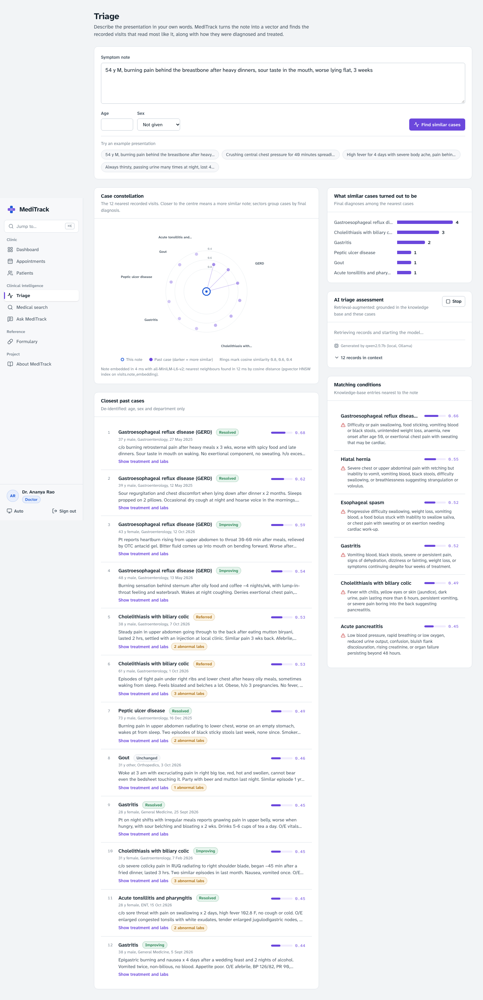

# MediTrack

Hospital records and AI-assisted triage on one PostgreSQL database. Appointments, visits, prescriptions and lab
results are relational tables; symptom notes, condition descriptions and drug indications are also stored as
384-dimension vectors (pgvector), so a doctor can describe a presentation in plain words and see the past cases
that read most like it, and how they turned out.

DBMS Experiential Learning, Level 3 project (Option 2: SQL + vector database)

| Team member | SRN |
|---|---|
| Kshitij Gupta | PES1UG24AM915 |
| Avinash MJ | PES1UG24AM347 |



## What it does

**Doctors**
- Today's queue, with a consultation workspace: as the note is typed, the nearest past cases and knowledge-base conditions appear.
- Prescriptions are checked live for drug interactions; a severe pair is refused by a database trigger.
- **Triage**: a case constellation plots the 12 nearest visits by cosine similarity and groups them by final diagnosis, plus a cited AI triage assessment (RAG).
- **Medical search**: natural-language search over conditions and the formulary, with keyword, semantic and hybrid ranking side by side.
- **Ask MediTrack**: a chat assistant answering only from retrieved hospital records, with clickable citations.
- Patient charts with lab trend charts, editable prescriptions (every edit audited) and an AI record summary.

**Administrators**
- Dashboard with live statistics from views and a materialized view.
- Users (doctor and patient profiles created in one transaction), departments and formulary stock.
- Prescription audit log written by a trigger.
- **DB Lab**: schema browser built from `pg_catalog`, a read-only SQL console with 22 key queries, and a live concurrent-booking race.

**Patients**
- Book and cancel appointments (free slots come from a SQL function).
- Read their own visits, prescriptions and lab results.

## Stack

| Layer | Choice |
|---|---|
| UI | Next.js 16 (App Router) + React 19, Tailwind CSS 4, TanStack Query |
| API | Next.js route handlers, NextAuth (credentials, JWT sessions, role checks on every route) |
| Database | PostgreSQL 17 with pgvector 0.8 and pg_trgm (Docker) |
| Data access | `node-postgres` with parameterised SQL. The business rules live in the database, so the SQL stays visible rather than hidden behind an ORM. |
| Embeddings | `Xenova/all-MiniLM-L6-v2` through transformers.js (ONNX, runs locally, 384 dims) |
| Generation | Ollama `qwen2.5:7b` locally by default; Claude if `ANTHROPIC_API_KEY` is set; retrieval-only fallback otherwise |

## Setup

Prerequisites: Node.js 20.9+, Docker, and optionally [Ollama](https://ollama.com) for AI answers.

```bash
cp .env.example .env.local      # then set the passwords and NEXTAUTH_SECRET (openssl rand -base64 32)
npm install
npm run setup                   # starts Postgres, builds the schema, seeds demo data (~1 min the first time)
npm run dev                     # http://localhost:3210
```

`npm run setup` downloads the embedding model (about 90 MB) into `.cache/models` on first use.

For AI-written answers, run `ollama pull qwen2.5:7b` (or set `ANTHROPIC_API_KEY` in `.env.local`). Without
either, retrieval still works and the AI panels show the retrieved records instead.

### Demo accounts

Every seeded account uses the password set in `DEMO_PASSWORD`. With `DEMO_MODE=true`, the sign-in page offers
one-click logins.

| Role | Email |
|---|---|
| Doctor | `ananya.rao@meditrack.in` (has today's queue) |
| Admin | `kshitij.gupta@meditrack.in`, `avinash.mj@meditrack.in` |
| Patient | `rahul.sharma@example.com` |

Today's queue is created relative to the day you seed. Run `npm run db:reset && npm run db:seed` on the morning of a demo.

## Scripts

| Command | What it does |
|---|---|
| `npm run dev` | Start the app on port 3210 |
| `npm run db:up` / `db:down` | Start or stop the Postgres container |
| `npm run db:migrate` | Apply `db/01…04` (create, alter, functions/triggers, views) |
| `npm run db:reset` | Run `db/00_drop.sql` and then rebuild everything |
| `npm run db:seed` | Load demo data and compute every embedding |
| `npm test` | 34 database tests: constraints, procedures, triggers, concurrency, vector search, privileges |
| `npm run build` | Production build |

## Layout

```
db/                    SQL, applied in order
  00_drop.sql          DROP every object (reset)
  01_schema.sql        CREATE extensions, enum types and the 13 tables from the relational schema
  02_alter_indexes.sql ALTER TABLE additions, generated tsvector columns, B-tree/GIN/trigram/HNSW indexes
  03_functions_triggers.sql  functions, stored procedures, triggers
  04_views.sql         views and the materialized view
scripts/               migrate.ts, seed.ts and the seed data
src/app/api/           REST route handlers (the backend layer)
src/app/(app)/         pages: dashboard, appointments, consult, patients, triage, search, assistant, formulary, admin
src/lib/               db pool and transactions, auth, embeddings, LLM providers, RAG retrieval
tests/db.test.ts       database test suite
docs/                  project report, ER diagram, relational schema, screenshots
```

Full documentation (problem statement, design, data dictionary, important queries, testing results) is in
[docs/PROJECT_REPORT.md](docs/PROJECT_REPORT.md).

## Troubleshooting

- **`npm install` fails with EACCES in `~/.npm`**: an old npm left root-owned files. Run `sudo chown -R $(id -u):$(id -g) ~/.npm`.
- **Port in use**: Postgres listens on `POSTGRES_PORT` (default 5433) and the app on 3210 (change it in `package.json`).
- **The AI panels say "retrieval only"**: Ollama isn't running or the model isn't pulled. Run `ollama serve` and `ollama pull qwen2.5:7b`.

Clinical content in the seed data is synthetic and for demonstration only. It is not medical advice.
